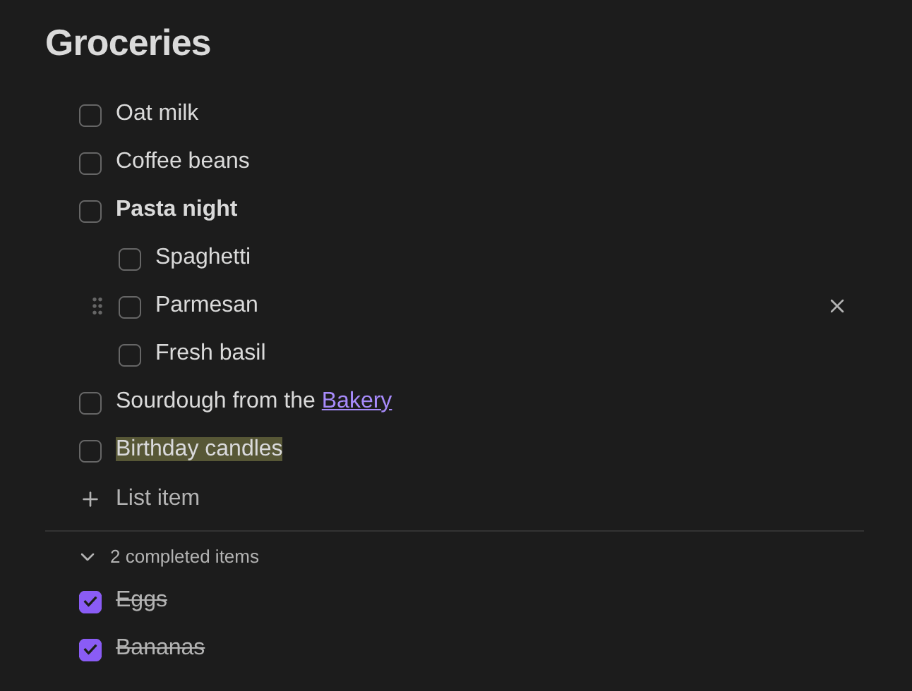

# Keep Lists

Google Keep-style checklists for Obsidian. Drag items to reorder or nest them, and checked items move to a collapsible completed section.



## Usage

Run **Keep Lists: Insert list** from the command palette, or type a `keep` code block:

````markdown
```keep
- [ ] list item 1
- [ ] list item 2
	- [ ] nested under item 2
- [x] done item
```
````

The block holds plain markdown checkboxes, so the note stays readable without the plugin.

- **+ List item** adds an item. **Enter** splits the item or adds one below, and **Backspace** on an empty item deletes it.
- Drag the grip to the left of the checkbox to reorder. Drag slightly **right** to nest an item, or **left** to un-nest it.
- **Tab** and **Shift+Tab** nest and un-nest. **↑** and **↓** move between items.
- Checked items move to the collapsible **completed** section, and unchecking returns them to where they were.
- Checking a parent checks its nested items. Pasting several lines creates one item per line.
- Item text is markdown. It shows formatted (bold, highlights, links…) and switches to raw markdown while you edit it.
- Your Obsidian hotkeys for Bold, Italic, Strikethrough, Highlight, Code, Math, Comment, Insert link, Insert wikilink, Set heading and Clear formatting apply to the item you're editing. Right-click an item for the same options.

## Installing

Search for **Keep Lists** in **Settings → Community plugins → Browse** once the plugin is listed in the community directory.

To install by hand, download `main.js`, `manifest.json` and `styles.css` from the [latest release](https://github.com/rafzzzzzz/obsidian-keep-lists/releases/latest) into `<your vault>/.obsidian/plugins/keep-lists/`, then enable **Keep Lists** under **Settings → Community plugins**.

## Building

```sh
npm install
npm run build    # writes main.js
npm run lint
VAULT=/path/to/vault npm run install-vault   # build and copy into a vault
```

## License

[MIT](LICENSE)
